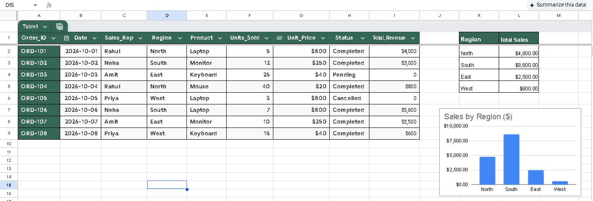

# 📊 Automated Sales Dashboard & Report (Google Sheets)

An automated sales tracking and regional performance dashboard built in **Google Sheets** to eliminate manual calculations and provide instant business insights.

## 🔗 Live Interactive Google Sheet
👉 **[Click Here to View Live Google Sheet] https://docs.google.com/spreadsheets/d/11MjIHl6DfmGwfSzPLPgKLtR247XHaMTPre66OfeMDms/edit?usp=sharing **

## ✨ Key Features & Formulas Used
* **Conditional Revenue Calculation:** Used `IF` logic (`=IF(H2="Completed", F2*G2, 0)`) to automatically calculate revenue only for completed orders while excluding pending or cancelled entries.
* **Automated Regional Summary:** Implemented `SUMIF` formulas to dynamically aggregate total sales across regions (North, South, East, West).
* **Data Visualization:** Built a clean, executive-ready column chart (`Sales by Region`) for quick performance comparison.
* **Professional Formatting:** Applied standardized currency formatting (`$`), color-coded headers, and structured layout for immediate client reporting.

## 📸 Dashboard Preview

